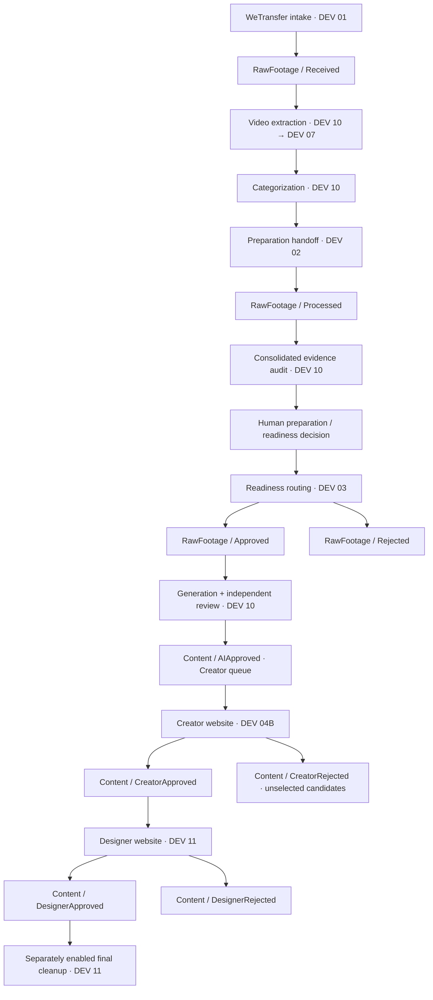

# AURA by Nada

## Automated Product-Content Pipeline

AURA turns a garment's original videos and photographs into a reviewed, four-image
product set. n8n coordinates intake, Google Drive storage, video-frame extraction,
evidence preparation, AI generation and independent review. Private Creator and
Designer websites keep final image selection and approval with people.

This repository contains the workflow exports, shared runtime source, three website
applications, offline tests and operating documentation for the complete project.

> **Release status — 16 October 2026:** the architecture uses eight operational
> workflows and two setup utilities. Reviewed exports and offline checks are available;
> the funded, whole-project acceptance test is still pending. Importing a workflow or
> uploading source to GitHub does not activate n8n, deploy a website or verify live services.

## Contents

- [System overview](#system-overview)
- [Required workflows](#required-workflows)
- [Processing and review contracts](#processing-and-review-contracts)
- [Google Drive organization](#google-drive-organization)
- [Schedules](#schedules)
- [Websites and integration](#websites-and-integration)
- [Repository guide](#repository-guide)
- [Installation and configuration](#installation-and-configuration)
- [Testing and release checklist](#testing-and-release-checklist)
- [Costs and credentials](#costs-and-credentials)
- [Operations and troubleshooting](#operations-and-troubleshooting)
- [Retired workflows](#retired-workflows)
- [Further documentation](#further-documentation)

## System overview

The unit of work is **one garment piece folder**, initially containing one original
source ZIP. Preparation and generation use real, authenticated source files. Filenames,
document contents and image text are evidence, not instructions that may override the workflow.



The Operations website reads stage lists through DEV 06 throughout the process.
AI review informs the humans; it does not replace readiness approval, Creator selection
or the Designer's final decision. `AIApproved` is the Creator queue's existing folder
name—not a guarantee that every candidate passed AI review.

## Required workflows

These **eight workflows** form the operational project. Links point to the current
exports; do not import retired alternatives alongside them.

| Workflow | Responsibility | Execution |
| --- | --- | --- |
| [DEV 01 — WeTransfer Intake](AURA%20Atomated%20Image%20Generation%20n8n%20Workflow/DEV%20-%2001%20WeTransfer%20Intake.json) | Receive trusted transfers and place the original ZIP under `Received`. | Daily intake cycle. |
| [DEV 07 — CloudConvert Frame Extraction](AURA%20Atomated%20Image%20Generation%20n8n%20Workflow/DEV%20-%2007%20CloudConvert%20Frame%20Extraction.json) | Extract video frames, preserve original photographs and save a verified combined ZIP. | Child workflow called by DEV 10. |
| [DEV 10 — AURA Essential Scheduled Skills](AURA%20Atomated%20Image%20Generation%20n8n%20Workflow/DEV%20-%2010%20AURA%20Essential%20Scheduled%20Skills%20%E2%80%94%20TEST%20FIRST.json) | Run extraction, categorization, consolidated auditing, generation and independent review. | Scheduled stages or an explicit manual stage job. |
| [DEV 02 — Raw Footage Preparation Handoff](AURA%20Atomated%20Image%20Generation%20n8n%20Workflow/DEV%20-%2002%20Raw%20Footage%20Preparation%20Handoff.json) | Move prepared pieces from `Received` to `Processed` after the genuine readiness marker exists. | Daily preparation cycle. |
| [DEV 03 — Manual Review Routing](AURA%20Atomated%20Image%20Generation%20n8n%20Workflow/DEV%20-%2003%20Manual%20Review%20Routing.json) | Route the human readiness decision from `Processed` into `Approved` or `Rejected`. | Daily routing cycle. |
| [DEV 04B — Creator Candidate Selection and Image Routing](AURA%20Atomated%20Image%20Generation%20n8n%20Workflow/DEV%20-%2004B%20Creator%20Candidate%20Selection%20and%20Image%20Routing%20.json) | Verify four exact Creator selections, archive other candidates and move the reviewed piece. | Authenticated website webhooks. |
| [DEV 11 — Designer Approval and 48-Hour Cleanup](AURA%20Atomated%20Image%20Generation%20n8n%20Workflow/DEV%20-%2011%20Designer%20Approval%20and%2048-Hour%20Cleanup%20%E2%80%94%20TEST%20FIRST.json) | Record revision-aware Designer decisions; perform separately enabled final cleanup. | Authenticated webhooks; six-hour cleanup check. |
| [DEV 06 — Operations Dashboard Backend](AURA%20Atomated%20Image%20Generation%20n8n%20Workflow/DEV%20-%2006%20Operations%20Dashboard%20Backend.json) | Supply stage counts, piece lists and Drive links to the Operations website. | Authenticated reporting webhook. |

DEV 10 invokes the four configured, version-1 skills directly: **categorizer, auditor,
generator and reviewer**. It does not call DEV 08 or DEV 08B. DEV 07 is not a second
pipeline to run independently in parallel with DEV 10.

### Setup utilities

Keep these available but inactive during normal piece processing:

- [AURA — Skill Setup](AURA%20Atomated%20Image%20Generation%20n8n%20Workflow/AURA%20%E2%80%94%20Skill%20Setup.json): skill discovery and setup maintenance; not a per-piece job.
- [Initialize Aura Drive Structure](AURA%20Atomated%20Image%20Generation%20n8n%20Workflow/Initialize%20Aura%20Drive%20Structure.json): initial folder bootstrap; do not rerun against a populated project.

The intended n8n inventory is **eight operational workflows plus two setup utilities**.
Source modules and tests in GitHub are not additional workflows to activate.

## Processing and review contracts

### 1. Source ZIP and video extraction

- Exactly one eligible source ZIP must sit **directly inside the piece folder**.
  Loose videos or images are not the extractor input contract.
- The ZIP may contain videos and existing photographs. **Only videos undergo frame
  extraction.** Original photographs are carried through unchanged.
- DEV 07 uses ffmpeg through CloudConvert, verifies original-image byte identity,
  and saves one `AURA_reference_images_<12hex>.zip` in the same piece folder.
- The combined ZIP contains extracted frames **and** the original photographs.
  Extraction does not modify or delete the original source ZIP.
- `AURA_reference_images_*.zip` outputs are excluded from source selection. Zero or
  multiple eligible source ZIPs cause an explicit failure rather than a guess.

Extraction makes no OpenAI inference calls. CloudConvert still consumes its own free
credits; DEV 07 checks the non-paying-account/free-credit conditions before conversion.

### 2. Evidence preparation and human readiness

The categorizer organizes readable, distinct source images into three canonical folders:

| Folder | Evidence |
| --- | --- |
| `01_MATERIAL_CLOSEUPS_4K` | Material, texture and close-up construction details. |
| `02_WHOLE_FRONT_BACK_SIDE` | Whole-garment front, back and side evidence. |
| `03_SIZE_FIT_MODEL_MANNEQUIN` | Size, fit, model or mannequin evidence. |

`READY_FOR_REVIEW.docx` marks completed preparation for DEV 02's handoff. The auditor
then processes **all eligible pieces in `Processed`** and produces one consolidated
`audit__AURA_by_Nada.docx` in the AURA root. An audit-complete receipt is not human approval.
The human preparation/readiness step supplies the genuine `READY_FOR_AURA.docx` used
by DEV 03. Do not fabricate readiness documents to bypass missing or failed evidence.

### 3. Four-image generation and independent review

Each piece follows this fixed, sequential view order:

| Order | View key | Deliverable |
| --- | --- | --- |
| 1 | `front` | Front product image. |
| 2 | `back` | Back product image. |
| 3 | `three_quarter_front` | Three-quarter-front product image. |
| 4 | `detail_collage` | Detail collage. |

The runtime requests `gpt-image-2.5-flare` for initial images and
`gpt-image-2.5-sunburst` only for needed precision repairs. Reasoning uses
`gpt-5.4-mini`. These are the repository's configured models; access must be verified
in the target OpenAI project before funded testing. There is no legacy image-model fallback.

- One image per request: `n=1`, high quality, **1536 × 1920**, opaque PNG.
- At most **three actual image attempts per view and twelve per piece**. Edits and
  model switches count toward the same limits.
- A reviewer PASS stops further attempts for that view.
- The reviewer receives the actual candidate and real same-piece references in a
  separate context. Generator claims do not substitute for independent inspection.
- Every actual candidate and its review are retained for human selection, including
  candidates that did not pass AI review.

### 4. Creator selection

The Creator website presents up to three candidates per view, twelve overall. The
Creator selects **exactly one front, back, three-quarter-front and detail-collage image**.
This means selecting product images—not selecting a person or content creator.

DEV 04B validates submitted IDs and the queue revision, verifies the four selected files
under `04_PRODUCT_IMAGE_OUTPUTS`, and archives unselected candidates separately under
`Content/CreatorRejected`. Original references follow the approved piece. The piece
moves into `CreatorApproved` only after the required file operations verify.

### 5. Designer approval and final retention

The Designer reviews the four selected images and submits a real approval or rejection.
The website preserves the current review revision and derives reviewer identity on
the server. DEV 11 rejects stale decisions and routes the piece to `DesignerApproved`
or `DesignerRejected`; it replaces DEV 05 on the existing Designer webhook paths.

Final cleanup is a **separate, explicitly enabled phase** after approval:

1. Retain the four exact approved image IDs as the final piece-root image set.
2. Move only recorded, non-final descendants of that approved piece to recoverable Trash.
3. Permit permanent purge only after **48 real hours from verified Trash**, with
   unchanged approval/content and explicit purge enablement.

The separate `CreatorRejected` archive is outside this cleanup scope. Cleanup does
not run inside an AI skill and makes no OpenAI inference calls. Inspect a dry run on
a disposable approved piece first; do not shorten the retention hold for testing.

## Google Drive organization

```text
AURA/
├── audit__AURA_by_Nada.docx        # Consolidated Processed-batch audit
├── RawFootage/
│   ├── Received/
│   ├── Processed/
│   ├── Approved/
│   └── Rejected/
└── Content/
    ├── AIApproved/                # Creator candidate queue
    ├── AIRejected/                # Historical stage
    ├── CreatorApproved/           # Selected sets awaiting Designer review
    ├── CreatorRejected/           # Separate unselected-candidate archive
    ├── DesignerApproved/
    └── DesignerRejected/
```

Before final cleanup, a prepared piece retains its source ZIP, combined reference ZIP,
category folders, readiness documents and generation records. Candidates are organized
below `04_PRODUCT_IMAGE_OUTPUTS/_run/candidates/<view>/`; selected files are direct
children of `04_PRODUCT_IMAGE_OUTPUTS` for Designer review.

`Content/Generated` is a legacy folder, not part of the current Operations dashboard.
Historical `AIRejected` entries and the separate candidate archive mean summed folder
counts are not necessarily a count of unique garments.

## Schedules

All daily times use **`Asia/Beirut`**, including daylight-saving changes—not a fixed
UTC offset. This is a processing cadence, not a same-day completion guarantee. Human
preparation or approval may defer a piece to the next eligible cycle.

| Local time | Workflow | Stage |
| --- | --- | --- |
| 09:00 | DEV 01 | WeTransfer intake. |
| 11:00 | DEV 10 → DEV 07 | Source ZIP extraction. |
| 12:00 | DEV 10 | Categorization. |
| 14:00 | DEV 02 | Prepared-footage handoff. |
| 16:00 | DEV 10 | Consolidated Processed-batch audit. |
| 18:30 | DEV 03 | Human readiness routing. |
| 00:05, following midnight | DEV 10 | Generation and independent review. |
| Every six hours | DEV 11 | Check final cleanup, subject to enable switches and retention rules. |

Creator selection, Designer decisions and Operations refreshes are website-driven.
Keep daily schedules unpublished while exercising explicit manual test stages.

## Websites and integration

| Application | Purpose | Source |
| --- | --- | --- |
| [Content Creator Review](https://aura-content-review.karimkhalil631.chatgpt.site) | Four-view candidate gallery and exact image selection. | [content creator website](content%20creator%20website/) |
| [Designer Review](https://aura-designer-review.karimkhalil631.chatgpt.site) | Final four-image approval or rejection. | [designer website](designer%20website/) |
| [Operations Dashboard](https://aura-operations-dashboard.karimkhalil631.chatgpt.site) | Stage lists, counts, filtering and Drive links. | [operations dashboard website](operations%20dashboard%20website/) |

The integration is **browser → authenticated website server route → authenticated
n8n webhook → Google Drive**. API keys and Basic Auth passwords stay server-side.
Private website sign-in and authorization to load private Drive images are separate
requirements; both must pass the live test. Do not make garment folders public as a workaround.

### Backend endpoints

Use the target n8n host plus these production paths:

| Application | Method and path | Backend |
| --- | --- | --- |
| Creator queue | `GET /webhook/creator-review/candidates` | DEV 04B |
| Creator selection | `POST /webhook/creator-review/selection` | DEV 04B |
| Designer queue | `GET /webhook/designer-review/pieces` | DEV 11 |
| Designer decision | `POST /webhook/designer-review/decision` | DEV 11 |
| Operations data | `GET /webhook/aura-dashboard/stats` | DEV 06 |

Configure each website's environment from its `.env.example`:

| Setting | Where used |
| --- | --- |
| `N8N_PIECES_URL` | Creator or Designer queue URL, matching that website. |
| `N8N_SELECTION_URL` | Creator selection submission URL. |
| `N8N_DECISION_URL` | Designer decision submission URL. |
| `N8N_DASHBOARD_URL` | Operations reporting URL. |
| `N8N_BASIC_USERNAME`, `N8N_BASIC_PASSWORD` | That website's server-side webhook authentication. |
| `AURA_CREATOR_PREVIEW` | Creator local preview only; leave `0` for live integration. |

Production websites require the corresponding authenticated n8n handlers to be
published. `/webhook-test/` URLs are temporary editor-test endpoints, not substitutes
for production paths. GitHub updates, Sites deployments and n8n publication are three
separate operations. See [Deployment Status](Architecture%20%26%20Design/Deployment-Status.md) for version provenance.

## Repository guide

```text
README.md
AURA Atomated Image Generation n8n Workflow/
├── DEV - ... .json                # Operational exports and setup utilities
└── creator-selection/             # Shared pipeline source, builders and tests
    ├── essential-runtime.mjs
    ├── essential_materializer.py
    ├── designer-cleanup-runtime.mjs
    ├── final-cleanup-plan.mjs
    ├── selection-core.mjs
    ├── routing-engine.mjs
    ├── traversal-core.mjs
    ├── build-*.mjs
    └── *.test.mjs / test_*.py
content creator website/          # Private Creator application
designer website/                 # Private Designer application
operations dashboard website/     # Private Operations application
Architecture & Design/            # Testing, deployment, budget and historical design
```

**Why is the source folder called `creator-selection`?** It originated with the Creator
backend and now also contains the shared DEV 10/11 runtime, builders, materializer and
tests. It is a historical directory name—not another website, workflow or processing
stage. Keep it: reviewed builders and tests use files in that directory.

The nested DEV 04B export is the builder's reviewed source export; the top-level DEV 04B
file is the account-export copy. They represent the **same workflow**, not two workflows
to import. Older drafts and legacy files may remain as implementation history; use the
[required-workflow list](#required-workflows) to identify deployment targets.

## Installation and configuration

### Prerequisites

- An n8n environment supporting the exported native node types and subworkflow calls.
- Authenticated Google Drive access to the configured AURA folders.
- A CloudConvert account meeting DEV 07's free-credit/account guard.
- An OpenAI project with credits, access to the configured models, and the four
  configured version-1 skills already uploaded.
- Private hosting and server-side environment configuration for all three websites.
- Node.js **24** and Python 3 for the documented offline checks; website dependencies
  are installed separately from each application's lockfile.

These exports are configured for the existing AURA account. Folder IDs, table IDs,
credential references, hosted skill IDs and the DEV 07 subworkflow reference are
account-specific. A new installation must deliberately remap them; JSON import alone
does not provision credentials, upload skills or recreate runtime state.

### Workflow installation

1. Back up saved n8n workflows before replacement. Preserve their existing workflow
   IDs so callers continue to target the correct backend.
2. Replace a graph only once. In the current editor, **Import from File adds nodes to
   the canvas**. For a full replacement, clear the backed-up canvas first, import once,
   and save. Do not delete the workflow record itself.
3. Rebind credentials where needed. DEV 10's `Call Existing CloudConvert Extractor`
   must call DEV 07, pass `pieceFolderId` and array-valued `sourceFileIds`, and wait for completion.
4. Verify the timezone on scheduled workflows. Keep exports inactive until their
   controlled test phase; import is not publication.

### Credentials and routing state

Existing credential references include `Aura Google Drive`, `CloudConvert – AURA`,
`AURA OpenAI Execution`, `AURA Creator Review` and `AURA Designer Review Login`.
Use each website's matching Basic Auth credential; Creator and Designer are not interchangeable.
DEV 06 also requires its configured reporting-webhook authentication.

The `AURA Routing State` table uses string columns `sourcePieceId`, `status`, `owner`,
`jobId` and `jobJson`, plus n8n's native ID and timestamps. Two mutex rows are required:

| `sourcePieceId` | Purpose | Idle values |
| --- | --- | --- |
| `__creator_mutex__` | Serialize verified Creator routing. | `status=idle`, `owner=none`, `jobId=none`, `jobJson={}` |
| `__aura_pipeline_mutex__` | Serialize pipeline jobs and protect paid progress. | `status=idle`, `owner=none`, `jobId=none`, `jobJson={}` |

`routing-state-seed.csv` and `essential-state-seed.csv` in the shared source directory
are for a **new, empty installation only**. Do not duplicate existing rows or overwrite
an active job journal with seed data.

### Enable switches

| Workflow | Switches in `AURA Configuration` | Safe imported default |
| --- | --- | --- |
| DEV 10 | `enabled`, `paidEnabled` | Both `false`. |
| DEV 11 | `enabled`, `cleanupEnabled`, `purgeEnabled` | All `false`. |

For the first extraction test, enable DEV 10 while keeping `paidEnabled:false`.
Authorize paid stages separately after extraction passes. For Designer review, enable
DEV 11 without enabling cleanup or purge. Do not turn every switch on together.

### Website development

From the chosen website's source folder:

```sh
npm ci
npm run dev
```

Keep local values in that application's uncommitted `.env.local`. Production secrets
belong in the hosting environment, not the repository.

## Testing and release checklist

Use [Whole-Project End-to-End Testing](Architecture%20%26%20Design/End-to-End-Testing.md)
as the operational procedure. Starting with a pre-existing source ZIP tests the
downstream pipeline, **not WeTransfer intake**.

### Offline checks

From the repository root:

```sh
cd "AURA Atomated Image Generation n8n Workflow/creator-selection"
node --test essential-runtime.test.mjs import-contract.test.mjs routing-engine.test.mjs selection-core.test.mjs traversal-core.test.mjs final-cleanup-plan.test.mjs
python3 -m unittest test_essential_materializer.py
```

Creator interface contracts, from the repository root:

```sh
node --test "content creator website/tests/creator-selection.test.mjs"
```

From each website's own folder, after installing dependencies:

```sh
npx tsc --noEmit --incremental false
npm run build
```

Workflow/runtime checks cover exported graph contracts, JSON/bodyless request routing,
binary handling, ZIP integrity, source delivery, candidate/review retention, Creator
routing, stale Designer decisions and cleanup planning. They do not call paid services
or establish live image quality. The reviewed runtime/Creator tests, Python materializer
checks and Creator/Designer TypeScript checks passed before this documentation update.

### Whole-project acceptance

- [ ] Intake creates one piece and its original ZIP without unintended duplicates.
- [ ] Extraction produces a readback-verified combined ZIP; original photographs are
  byte-identical, and the source ZIP remains intact.
- [ ] Categorization, genuine readiness documents and handoffs use the real sources.
- [ ] The consolidated auditor covers the intended Processed batch; human readiness
  approval is recorded before generation routing.
- [ ] Four views are generated sequentially, independently reviewed and retained
  within the three-per-view/twelve-per-piece attempt limits.
- [ ] The real Creator website routes the exact four selected IDs and archives other
  candidates without losing references.
- [ ] The real Designer website loads selected images, accepts a current decision and
  rejects a stale revision.
- [ ] The Operations website reflects the piece's actual location and Drive links.
- [ ] Cleanup's dry run shows the correct retain/trash IDs. Real purge is verified
  separately after the genuine 48-hour hold.

Live CloudConvert conversion, account/model access, website authentication, private
image delivery and garment-image quality remain acceptance-test requirements.
Publish daily schedules only after their stages pass. Restore `paidEnabled:false`
between controlled tests until scheduled paid operation is deliberately approved.

## Costs and credentials

The provisional allowance is **$50–$100 in OpenAI usage per month for 10–15 pieces**,
with **$100–$150 or more** possible under frequent repairs or large reference contexts.
Start with **$10–$20 for the first controlled test**, then revise the estimate using
billed usage. These are planning allowances—not a measured average, quoted per-image
price or guaranteed spending cap.

Ten to fifteen pieces require 40–60 final images, but may consume up to 120–180 actual
image attempts. Include categorization, auditing, reference/vision inputs, reasoning,
independent review and container usage. n8n, CloudConvert and hosting are separate.
See [Costs and API Keys](Architecture%20%26%20Design/Costs-and-API-Keys.md) for dated rate
references, assumptions and account-specific key recommendations.

Extraction, schedules, Drive moves, dashboards, human decisions and deletion make
**zero OpenAI inference calls**. Attempt limits, disabled automatic paid retries,
source bounds and persistent job journals are cost controls—not optional error-handling extensions.

Keep the runtime execution key active. Retire the temporary `AURA n8n Setup` discovery
key after setup if it is still active, and leave `AURA Skills Migration` revoked.
Never commit keys or passwords. Store secrets server-side and rotate keys by updating
the application and verifying its replacement before revoking the old key, following
[OpenAI's production guidance](https://developers.openai.com/api/docs/guides/production-best-practices#api-keys).
This repository does not revoke account credentials or certify their current status.

## Operations and troubleshooting

| Symptom | Check before taking action |
| --- | --- |
| No eligible source ZIP | List the piece folder itself; confirm exactly one original ZIP at its top level. An empty category subfolder does not prove the piece is empty. |
| Pipeline is locked | Inspect the owning execution, journal and external job/request IDs. Reconcile uncertain submissions before a deliberate release; never reset automatically. |
| Body or Content Type validation failure | Preserve separate body/bodyless paths. Send Body uses fixed booleans; Content Type stays JSON on JSON-body nodes. Do not paste a boolean expression into Content Type. |
| Duplicate disconnected node groups | An import may have added a second graph. Restore from backup or replace the intended graph carefully; do not run both copies. |
| Website queue unavailable | Check production webhook publication, server environment URLs and matching Basic Auth—not only website publication. |
| Private thumbnails fail | Inspect image delivery and authentication. Do not expose Drive folders publicly. |
| Designer decision is stale | Reload and review the current set; do not remove revision validation. |
| Paid request failed or timed out | Record the execution, failing node, response and job/request IDs. A failed response does not prove no charge occurred; do not repeatedly execute or erase paid progress. |

Keep routing journals, checksums, readback verification and locks: they protect against
duplicate charges, stale approvals, wrong-folder moves and unintended deletion.
Back up live exports after intentional n8n changes; GitHub is not an automatic mirror
of saved canvases or runtime state.

## Retired workflows

These six workflows are **not dependencies of the current architecture**. They were
removed from the active n8n inventory during cutover; do not reimport them for testing.
Any retained source or Git history is recovery material only.

| Retired workflow | Replacement or reason |
| --- | --- |
| DEV 04 — Content Creator Review Dashboard Backend | DEV 04B's per-view candidate selection. |
| DEV 05 — Designer Review Dashboard Backend | DEV 11's revision-aware Designer decisions. |
| DEV 08 — AURA Skill Runner | DEV 10's direct four-skill orchestration. |
| DEV 08B — Audit Source Preparation — BUILD ONLY | Superseded audit preparation branch. |
| DEV 08B — Synthetic Empty Evidence Self-Test | Development-only self-test, not an operational workflow. |
| DEV 09 — Verified ZIP Cleanup After Generation and Review | Superseded early-deletion policy; DEV 11 owns final cleanup after Designer approval. |

The two setup utilities and shared `creator-selection` source directory are **not**
part of this retired list. Historical documents may describe earlier DEV 08/09 routes;
this README and the current end-to-end guide define the current route.

## Further documentation

| Guide | Contents |
| --- | --- |
| [End-to-End Testing](Architecture%20%26%20Design/End-to-End-Testing.md) | Controlled test order, imports, account bindings, expected results and failure handling. |
| [Costs and API Keys](Architecture%20%26%20Design/Costs-and-API-Keys.md) | Budget assumptions, dated official pricing references and credential lifecycle. |
| [Deployment Status](Architecture%20%26%20Design/Deployment-Status.md) | Website version provenance and source/deployment/activation boundaries. |
| [Shared Runtime Guide](AURA%20Atomated%20Image%20Generation%20n8n%20Workflow/creator-selection/README.md) | Runtime modules, reviewed builders, state seeds and offline checks. |
| [Creator Website](content%20creator%20website/README.md) | Candidate-selection interface and local setup. |
| [Designer Website](designer%20website/README.md) | Final review interface and revision-aware submission. |
| [Operations Website](operations%20dashboard%20website/README.md) | Reporting views, server integration and local setup. |
